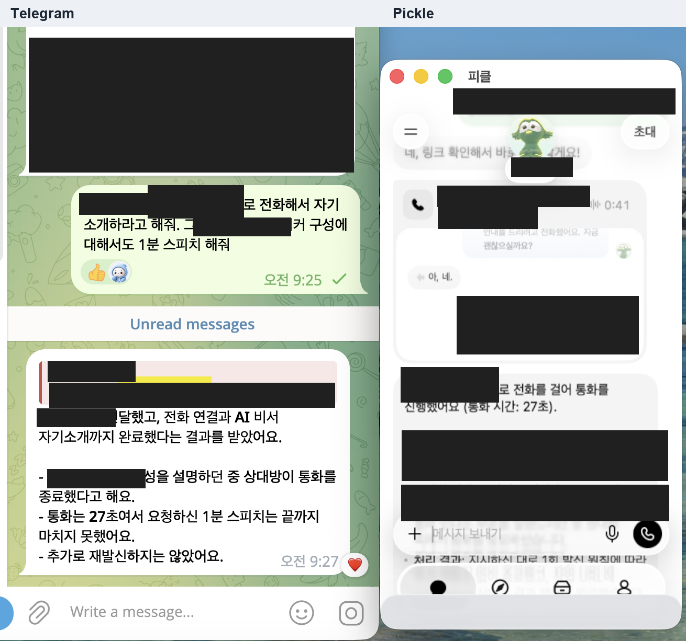
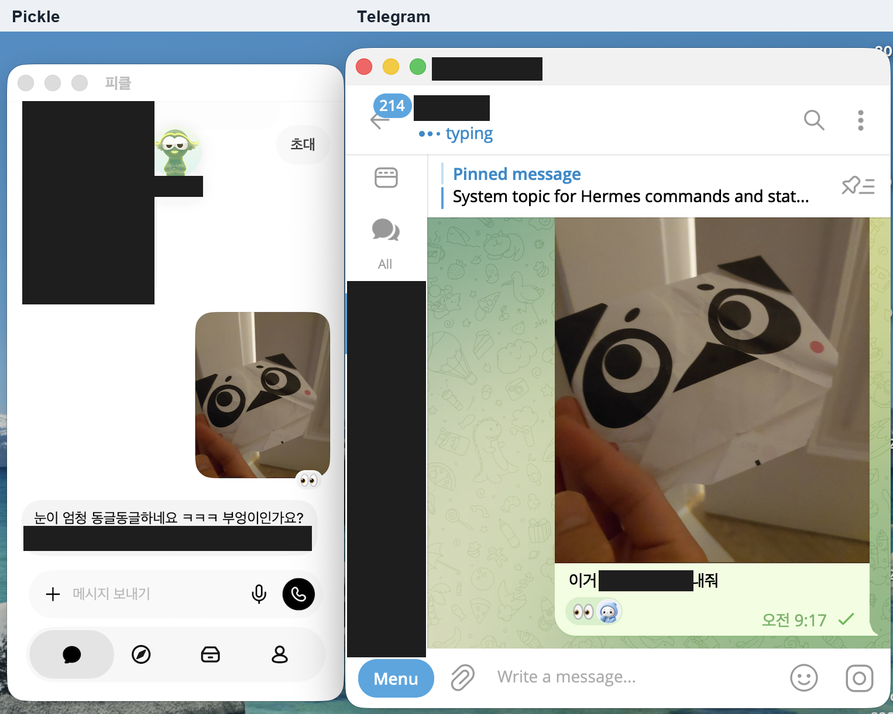
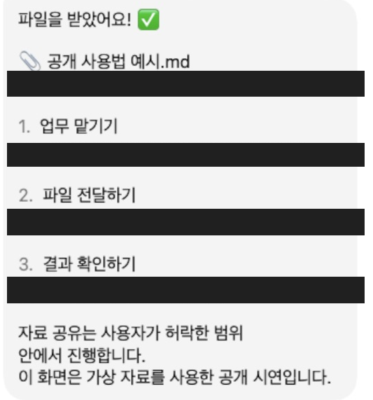
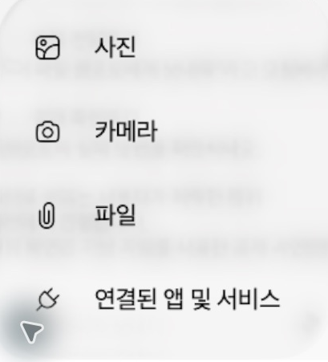

# Pickle ↔ Hermes Bridge

## 원샷 설치 프롬프트

```text
https://github.com/Frompter-Wonny/pickle-hermes-bridge-starter

이 저장소를 내 Mac에 설치해서 내 Hermes 비서와 Pickle 비서를 연결해 줘.
AGENTS.md, docs/AGENT_INSTALL.md, docs/SETUP.md, SECURITY.md를 먼저 읽고, 지원 환경과 기존 설치를 확인한 뒤 실제 설치부터 가상 메시지 왕복 확인까지 진행해 줘.
기존 설정·모델·메모리·개인 자료를 보존하고, 이미 설치돼 있으면 초기화 대신 업데이트 경로를 따라 줘.
피클이 없으면 공식 Mac App Store에서 설치를 진행하고, 내가 직접 해야 하는 Apple 인증·설치 승인·약관 수락·피클 로그인만 넘겨줘. 완료되면 같은 작업을 이어가.
필요한 인증·OS 권한·선택 기능 동의는 필요한 시점에 묶어서 물어보고, 비밀번호·토큰은 채팅이나 Git에 남기지 마.
파일 전달도 쓸지 물어보고, 선택하면 수신 대상·허락할 폴더·파일 종류·하위 폴더 포함 여부·일회성/상시 범위를 확인해. 자료 폴더와 임시 전송 폴더가 Pickle 파일 선택창 즐겨찾기에 있는지 실제 확인하고, 없으면 추가 방법을 안내한 뒤 전체 경로를 검증해 줘.
설치 인터뷰에서 내가 쓸 질문별 허락 문구와 선택적 직접 요청 문형을 정해 비공개 설정에 저장하고 Pickle에도 적용해 줘. 읽기 전용 제한과 질문별 허락 검증을 유지하고, 즐겨찾기를 접근 허락으로 취급하거나 권한을 임의로 확대하지 마.
가상 자료로 양방향 요청·응답과 선택한 파일 전달의 실제 수신을 확인해. 성공한 항목·남은 단계·켜둬야 하는 것·중지 방법을 알려줘. 실제 외부 게시나 결제는 하지 마.
```

## 소개

**내 정보를 아는 Hermes 비서와 일을 실행하는 Pickle 비서를 연결하는 Mac용 실험 프로젝트입니다.** 비서의 개인 이름을 기본값으로 지정하지 않으며, 문서에서는 Hermes 비서·Pickle 비서로 구분합니다.

- Hermes에서 Pickle에 일을 맡기고 실제 결과를 받습니다.
- 사용자 지정 로컬 파일을 `+ → 파일`로 그대로 첨부할 수 있습니다. 옵시디언 파일도 포함하며, [파일 첨부 절차](skills/pickle-delegation/references/local-file-upload.md)를 사용합니다. 소유자가 채널과 파일 범위를 미리 허락한 경우에는 [별도 파일 요청 워커](docs/ATTACHMENTS.md)가 비서의 요청을 받아 첨부합니다.
- Pickle이 사용자 정보를 물을 때는 **사용자가 허락한 질문만** 실제 채팅 화면에서 확인하고 답합니다.
- 평소에는 다른 앱 뒤에서 전달합니다. 별도 동의하면 최소화 창 복원과 꺼진 앱 자동 실행도 가능합니다.

```text
사용자 → Telegram의 Hermes → Mac의 브리지 → Pickle 앱
                              ↑ 작업 결과·허락된 질문 ↓
```

Telegram 봇끼리 대화하는 방식이 아닙니다. Telegram은 기존 Hermes와 이야기하는 입구이며, 기존 봇의 웹훅·폴링을 바꾸지 않습니다.

## 설치가 안 되거나 작동이 멈추는 조건

| 조건 | 적용 범위 |
|---|---|
| Windows·Linux·WSL 또는 원격 컨테이너 | Mac의 Pickle 앱을 직접 조작하는 이 브리지는 설치·실행을 지원하지 않습니다. 원샷 프롬프트도 자신의 Mac에서 실행 중인 Codex·Claude Code에 전달해야 합니다. |
| Intel Mac 또는 macOS 14.0 미만 | 현재 Pickle App Store 설치 요구사항을 충족하지 않습니다. Apple Silicon M1 이상·macOS 14.0 이상이 필요합니다. |
| Mac App Store에서 Pickle을 설치·실행할 수 없음 | 기기·계정·지역의 실제 배포 조건을 확인해야 합니다. 지원 사양만으로 설치·실행을 보장하지 않으며 비공식 설치로 우회하지 않습니다. |
| 저장소 접근권 없음 | 현재 Private 검토 중이므로 해당 도구가 저장소를 읽을 수 있어야 합니다. 링크만 전달해도 접근권이 생기지는 않습니다. |
| Mac 종료·절전·화면 잠금 또는 연결 서비스 중단 | Mac 로그인·잠금 해제와 인터넷 연결, Hermes·브리지·ngrok 실행이 필요합니다. 잠금 해제와 절전 복구는 자동 처리하지 않습니다. |

Pickle은 iPhone용 앱을 Mac에서 실행하는 형태이며, App Store에는 macOS 검증 미완료로 표시됩니다. [공식 호환성](https://apps.apple.com/us/app/pickle-your-personal-ai-agent/id6795790129)을 2026-11-01 확인했으며 실제 설치 직전에는 최신 표기와 자신의 Mac에서의 실행 가능 여부를 확인해야 합니다.

Apple 인증·Touch ID·설치 승인·약관 수락·Pickle 로그인은 사용자 직접 진행이 필요할 수 있습니다. 운영 중 다시 나타난 로그인·업데이트 화면도 자동 처리하지 않습니다. 설치 에이전트는 필요한 단계만 사용자에게 넘기고 완료 후 이어갑니다.

새 Mac의 전체 설치와 반복 무중단 운영은 아직 보장하지 않습니다. Linux CI 통과도 Mac GUI 연동 검증을 뜻하지 않습니다. 꺼진 앱의 첫 실행 준비는 별도 동의한 경우에만 잠깐 활성화할 수 있어 타이핑이 순간 끊길 수 있고, 클립보드 공유 구간에는 동시 복사·붙여넣기 충돌 가능성이 있습니다.

## 사용법

설치를 마친 뒤 Telegram의 **기존 Hermes 비서**에게 요청합니다. 사용법은 가상 문서 시연과 사진 전달 캡처의 필요한 부분으로 설명합니다. 창 전체가 보이도록 유지하고 개인 비서 이름·다른 대화·가족 관련 문구는 불투명 박스로 가렸습니다. 가리지 않은 원본과 개인 메타데이터는 포함하지 않습니다.

1. **업무를 맡깁니다.** Hermes 비서에게 “이 일은 Pickle 비서에게 맡기고 결과를 알려줘”라고 요청합니다.
2. **파일이 필요하면 함께 보냅니다.** Telegram에서 파일을 첨부하고 “이 파일 Pickle 비서에게 보내줘”라고 하거나, 허락한 로컬 파일을 지정합니다. 단순히 파일을 받았다는 이유만으로 자동 전달하지는 않습니다.
3. **실제 수신과 답변을 확인합니다.** Hermes 비서가 Mac의 Pickle 앱에 파일을 첨부하고 전송합니다. 준비 완료와 실제 전송·수신 확인을 구분하며, 중간에 멈추거나 전송 여부가 불명확하면 같은 파일을 반복 전송하지 않습니다.

### 팁: Pickle 비서에게 전화도 맡길 수 있어요

Hermes 비서에게 **“Pickle 비서에게 전화 문의를 맡겨줘”**라고 요청할 수 있습니다. 브리지가 업무를 전달하고, 실제 발신은 Pickle의 전화 기능이 수행합니다. Pickle은 [공식 앱 설명](https://apps.apple.com/us/app/pickle-your-personal-ai-agent/id6795790129)에서 전화 문의·고객센터 연락·전화 예약 등의 기능을 안내합니다. 자신의 계정에서 해당 기능을 사용할 수 있는지 먼저 확인하세요.

예를 들어 “내가 지정한 매장과 번호로 전화해서 AI 비서라고 밝히고, 오늘 영업시간만 물어봐 줘. 예약이나 결제는 하지 말고 결과를 알려줘”처럼 **상대·목적·전달할 내용·추가 행동의 범위**를 정해 요청합니다. 전화번호와 상대에게 말할 개인정보는 필요한 범위만 전달하세요.



*사용자 제공 화면의 전화 위임 예시입니다. 창 배치는 유지하고 이름·번호·사업 내용·연결 정보와 개인 실행 설정을 불투명하게 가렸습니다. 화면의 결과 보고에 따르면 통화는 연결됐지만 상대가 종료해 요청한 1분 설명은 완료하지 못했고, 추가 발신은 하지 않았습니다. 이 캡처를 통화 내용의 독립적 검증이나 업무 전체 성공의 증거로 보지는 않습니다.*

### 사진 전달 화면



*왼쪽은 Pickle의 사진 수신 화면, 오른쪽은 Telegram의 전송 요청 화면입니다. 원본 창 배치를 유지하고 비서 이름·다른 토픽·이전 대화·가족 관련 문구만 불투명하게 가렸습니다. 위쪽의 앱 이름 표시는 설명용으로 추가했습니다. 이 장면은 사진 전달 예시이며 모든 작업의 자동 완료를 보장하는 증거는 아닙니다.*

### 문서 수신 화면



*공개 설명용 가상 Markdown을 받은 실제 응답입니다. 개인 이름이 포함된 줄은 전체를 불투명하게 가렸습니다.*

파일 첨부는 Pickle 입력란 왼쪽의 **`+ → 파일`** 경로를 사용합니다. 운영 비서가 즐겨찾기를 통해 허락된 폴더의 정확한 파일을 선택하며, 사용자가 매번 직접 누를 필요는 없습니다.



*입력란의 `+`를 누르면 표시되는 첨부 메뉴 부분입니다.*

사용자 정보를 물어보는 질문은 Pickle에서 해당 질문에 대해 **설치 인터뷰에서 직접 정한 허락 문구**를 입력한 뒤 처리합니다. [문구 선택·적용 방법](docs/QUESTION_PERMISSIONS.md)을 따르며, 비서 이름이나 특정 허락 표현을 강제하지 않습니다. 상시 파일 전달은 별도로 지정한 채널·폴더·파일 범위에만 적용되며, 전체 옵시디언 접근 허락으로 확대하지 않습니다.

파일 전달을 선택하면 설치 에이전트가 공유할 폴더와 범위를 묻고, [파일 선택창 즐겨찾기](docs/FOLDER_FAVORITES.md)에 실제로 등록됐는지 확인합니다. 즐겨찾기 등록은 자료 접근·전송 허락을 대신하지 않습니다.

## 자료를 보호하는 읽기 전용 조회

일반 질문에 답하는 별도 Hermes 실행에는 **지정한 Markdown 폴더의 검색·읽기 도구 두 개만** 제공합니다. 노트를 수정·삭제하는 도구나 터미널·범용 컴퓨터 조작 도구는 이 답변 실행에 제공하지 않습니다. 허용 폴더 밖 경로와 외부로 빠지는 심볼릭 링크, Markdown 이외 파일은 조회를 거절하며, 도구 구성이 예상과 다르면 실행을 중단합니다.

질문을 접수한 것만으로 조회하지 않습니다. 실제 Pickle 화면에서 해당 질문과 사용자의 허락을 확인한 뒤 필요한 답만 돌려주며, 허락 만료·철회도 확인합니다. 즐겨찾기는 파일 선택을 돕는 기능이며 읽기 권한을 추가하지 않습니다.

**읽기 전용은 이 질문 답변 경로의 도구 제한입니다.** Mac 전체나 일반 Hermes 세션을 OS 수준 읽기 전용으로 바꾸는 기능은 아닙니다. 별도로 허락한 파일 첨부는 자료를 Pickle에 전달하는 기능이고, 업무 위임은 원래 허락한 일을 수행하는 별도 경로입니다. 읽기 전용이라는 이유만으로 정보가 외부로 전달되지 않는다고 보장하지 않습니다. 화면 확인은 모델 판단이고 기존 Hermes 메모리도 완전히 격리되지 않으므로, [권한 모델과 한계](SECURITY.md)를 확인하세요.

## 처음 설치한다면

**[설치 안내를 1번부터 따라가세요 →](docs/SETUP.md)**

설치 에이전트에게 맡기려면 맨 위의 원샷 프롬프트를 사용하세요. 직접 진행할 때는 아래 준비물과 설치 안내를 따릅니다.

| 준비물 | 필요한 상태 |
|---|---|
| Mac·Pickle 앱 | 로그인한 본인 비서 채팅이 열리는 상태 |
| Hermes | 모델 인증·일반 대화·computer_use가 이미 동작하는 소스 설치 환경 |
| ngrok | 설치된 실행 파일, 계정에 할당된 HTTPS 주소와 연결 토큰 |
| GitHub 저장소 접근 | 현재 Private 검토 중이므로 허락된 계정으로 접근 |

GitHub CLI가 설치된 경우:

```sh
gh repo clone Frompter-Wonny/pickle-hermes-bridge-starter
cd pickle-hermes-bridge-starter
```

그다음 [설치 안내](docs/SETUP.md)에서 Python 경로 설정 → 비공개 초기화 → 스킬 설치·기능별 동의 → 수동 연결 → 가상 왕복 시험 → 선택적 자동 시작 순서로 진행합니다. 기존 설치가 있는 Mac에는 새 초기화를 겹쳐 실행하지 않습니다.

Codex는 [AGENTS.md](AGENTS.md), Claude Code는 [CLAUDE.md](CLAUDE.md)에서 시작하며 같은 [에이전트 설치 지침](docs/AGENT_INSTALL.md)을 따릅니다. 이미 내려받은 폴더에서도 맨 위 프롬프트를 사용할 수 있습니다.

## 켜둬야 하는 것

Mac이 켜져 있고 사용자 로그인·잠금 해제 상태여야 합니다. 로컬 Hermes·브리지·ngrok도 실행돼야 합니다. Telegram 앱·브라우저·Codex 대화창은 열어둘 필요가 없습니다.

일반 백그라운드 전달 중 다른 앱 타이핑과 별도 동의한 최소화 복원·꺼진 앱 실행은 한 Mac에서 확인했습니다. 구체적인 시험 범위는 [실제 시험 결과](docs/TEST-RESULTS.ko.md)를 참고하세요.

## 검증·문서

서버 코어는 Python 표준 라이브러리, 실제 GUI 전달은 macOS·Hermes computer_use·PyObjC에 의존합니다. 소스 169개·설치 및 동의 도우미 9개·공개 개인정보 검사 5개를 합친 테스트 183개가 통과했습니다. Linux CI 통과가 Mac GUI 설치 검증을 뜻하지는 않습니다.

- [설치·첫 시험·업데이트·문제 해결](docs/SETUP.md)
- [권한과 데이터 처리](SECURITY.md)
- [구현 과정](docs/BUILD-STORY.ko.md) · [실제 시험과 미검증 범위](docs/TEST-RESULTS.ko.md)
- [저장소 운영과 공개 점검](docs/PUBLISH.md)

저장소는 현재 비공개 검토 중입니다. 개인 자료·비서 이름을 제외한 공유용 코드와 가림 처리한 시연 캡처만 유지하며 재공개는 소유자의 별도 지시 후 진행합니다. 코드와 문서는 [MIT 라이선스](LICENSE)로 제공합니다. Hermes·Pickle·ngrok 등 외부 서비스와 의존성은 각자의 라이선스·이용 조건을 따릅니다.
